# reeftech-catalog

Data catalog of the ReefTech ecosystem: non-connected equipment with their
maintenance tasks, dosing supplements, reference parameters and water tests. Adding a heater model or a new
supplement is a pull request here, not a new release of the integrations or of
the cards.

| Section | Content | Downloaded by | Shown by |
|---|---|---|---|
| `equipment` | task library, equipment categories (generic image and tasks), equipment models | [reef_maintenance](https://github.com/Elwinmage/ha-reef-maintenance-component) (scope `aquarium`), [maintenance_hub](https://github.com/Elwinmage/ha-maintenance-hub) (all scopes) | ha-reef-card (RSPower sockets, maintenance view), maintenance hub card |
| `supplements` | supplements, bottle visuals, dosing data | [redsea](https://github.com/Elwinmage/ha-reefbeat-component) | ha-reef-card (ReefDose) |
| `parameters` | water parameters: unit, reference band, and for those ReefDose can regulate the `regulation` data (tolerance, largest daily correction, step) | [redsea](https://github.com/Elwinmage/ha-reefbeat-component), [reeftank](https://github.com/Elwinmage/ha-reeftank-component) | ha-reef-card (reef parameters, ReefDose) |
| `water_tests` | water test kits and checkers, with the conversion tables of their titrations | [redsea](https://github.com/Elwinmage/ha-reefbeat-component), [reeftank](https://github.com/Elwinmage/ha-reeftank-component) | ha-reef-card (ReefDose) |

The cards never access the network: integrations download the releases, check
them, keep them under `<config>` and serve them locally, with a built-in
snapshot for their first start and for offline installs. The integration side
is written once in [`client/`](client) and copied into each integration by
`scripts/sync_client.py`. See [doc/consumers.md](doc/consumers.md).

## Layout

```
schema/                         JSON schemas (2020-12)
equipment/
  tasks/<task_id>.json          maintenance task templates
  categories/<category_id>/
    category.json               name, scopes, icon, default tasks
    image.webp                  generic visual (optional)
    thumb.webp                  small visual for lists (optional)
  items/<item_id>/
    item.json                   category, brand, model, power, task overrides
    image.webp / thumb.webp     (optional, category visual otherwise)
supplements/
  items/<supplement_id>/
    supplement.json             kind, colour, dosing data
    image.webp / thumb.webp     bottle visual (optional, generic bottle otherwise)
water_tests/
  items/<water_test_id>/
    water_test.json             brand, name, tests (parameter, method, table)
    image.webp / thumb.webp     product visual (optional)
scripts/                        validate.py, make_release.py, sync_client.py
client/                         catalog client copied into the integrations
```

A file or folder name is the entry id. Ids are **stable**: user
configurations refer to them, so an entry is never renamed, only removed.

## Parameters

A parameter has a display `unit`, a reference `range` (`min`, `low`, `optimal`,
`high`, `max`) and, when ReefDose can regulate it, a `regulation` block in that
unit: `tolerance` (gap to the target under which nothing is corrected),
`max_rate` (largest correction per day) and `step`. The default target is
`range.optimal`; a parameter without `regulation` is not offered for
regulation. Trace elements are in ppb (iodine, iron).

## Water tests

An entry is a product (a kit, an electronic checker) measuring one `parameter`
of the parameters catalog, in the unit of that parameter (a single test, kept in
the `tests` list for the format). A kit that tests several parameters is one
entry per parameter; two ranges of the same parameter are two entries.

- `method: direct`: the value is read (checker, colour chart). An optional
  `range` says what the test can read.
- `method: titration`: the user counts the reagent used (`ml` or `drops`) and
  the manufacturer `table` (points `amount -> value`) turns it into a value;
  between two points the value is interpolated linearly, outside the table
  nothing is extrapolated. The readable range comes from the table.
- Tables come from the manufacturer manuals; `verified: true` needs a `source`.
  An unverified test can be used: the card shows a warning that its table was
  not checked.

```json
{
  "brand": "Red Sea",
  "name": "Reef Foundation Test Kit",
  "tests": [
    {
      "parameter": "kh",
      "unit": "dkh",
      "method": "titration",
      "table": {
        "amount_unit": "ml",
        "points": [{"amount": 0.5, "value": 12}, {"amount": 1, "value": 6}]
      }
    }
  ],
  "verified": false
}
```

`client/catalog_conversion.py` does the conversion for the consumers.

## Equipment

- **Scopes** (`aquarium`, `pool`, `home`) say where an equipment lives.
  reef_maintenance keeps `aquarium` entries, maintenance_hub keeps all of them.
- A **category** works on its own: an equipment linked to “heater” already gets
  a visual and the usual heater tasks. A **model** only refines it (own visual,
  nominal power, other intervals).
- **Tasks** are shared templates (`equipment/tasks/`) carrying names and
  descriptions in every language. Categories and models reference them and may
  override `schedule` and `regulatory`. A model keeps its category tasks unless
  `inherit_maintenance` is `false`.
- **Schedules** are either `interval` (unit `days`/`weeks`/`months`/`years`,
  with a default and the bounds the user may choose within) or `seasonal`
  (yearly anchor date, task due `window_days` before it).

```json
{
  "category": "heater",
  "brand": "Eheim",
  "model": "thermocontrol 200",
  "power_w": 200,
  "maintenance": [
    { "task": "heater_clean", "schedule": { "type": "interval", "unit": "months", "every": { "default": 6, "min": 3, "max": 12 } } }
  ]
}
```

## Supplements

The 95 supplements of ha-reef-card (12 brands, with their bottle visuals) live
here; the card no longer embeds them.

- `uid`: Red Sea cloud uid (the card and redsea look supplements up by it);
  `fullname`: `<brand> - <name>` as known by the ReefBeat library. Both are
  unique and never change.
- `name` is the product name as printed (not translated); `display_name` and
  `short_name` are the labels of the dosing head and of the bottle visual.
- `sizes`: bottle sizes in mL offered for the container volume.
- `kind`: `kh`, `ca`, `mg`, `trace`, `nutrient`, `food`, `bundle`, `brine`,
  `other`.
- `bundle` (kind `bundle` only): its parts, each one another supplement of the
  catalog, with a slot and a dosing ratio to part 1 (Red Sea ReefCare).
- `effects`: raise of a parameter for **1 mL in 100 L**, used by the automatic
  dose proposal. Values outside plausible bounds are rejected by the checks.
- `verified`: dosing data checked against the manufacturer, with a `source`.
  Unverified effects are never used for automatic proposals.
- `brine` (DIY Brine) is the only kind with `concentration_g_l` and the only
  one allowed to drive salinity regulation (`"regulation": ["salinity"]`); its
  raise is computed from the concentration, so it has no `effects`.

## Releases

*Actions → Release* publishes one section or both (`all`, the default), with
a version like `2026.11.0`. Each section keeps its own releases; with `all`, a
section without any change since its previous release is skipped.
`min_integration` takes one list for both sections (`redsea=2.1.0
reef_maintenance=0.3.0`), each section keeping its own consumers.

- `<section>-<version>`: the archives of the entries that changed, the manifest
  and the notes. Unchanged entries keep pointing to the release that built them,
  so integrations only download what changed. **Never delete a versioned
  release.**
- `<section>-latest`: only the current `manifest.json`, at a fixed URL.

Each release also carries `schema.zip`: the JSON Schemas of the section (data
only, never code), referenced by the `schema` record of the manifest. Tools that
edit the catalog check their drafts against the schemas of the release the
integrations have installed; the integrations reading the entries ignore it.

After a release, run `sync_client.py` so that the next version of each
integration ships an up-to-date built-in snapshot.

The manifest gives, per entry, its kind, scopes, archive, sha256, size and the
version that last changed it, plus the oldest version of each integration able
to read the section (`min_integration`).

## Checks

```
pip install -r requirements.txt
pre-commit install                  # same checks as the CI, before each commit
python scripts/validate.py          # errors fail, warnings are listed
python scripts/validate.py --strict # warnings fail too
python scripts/readme_catalog.py    # refresh the lists of this README (the CI does it after a merge)
pytest --cov=scripts --cov=client
python scripts/sync_client.py --base .. [--check]  # refresh the integrations' copies
```

Warnings are missing translations of tasks and equipment (`en` is
mandatory, `fr de es it pl pt` expected), missing visuals and unverified
dosing data. See
[CONTRIBUTING.md](CONTRIBUTING.md) to add an entry.

## Catalog content

The lists below are written by `scripts/readme_catalog.py` from the catalog
itself. The *README lists* workflow refreshes them after each merge on `main`,
so a pull request only adds the folder of its entry.

<!-- catalog:begin -->
<!-- Generated by scripts/readme_catalog.py: do not edit by hand -->

<details>
<summary><b>Equipment categories</b> (20)</summary>

|  | Id | Category | Scopes | Default tasks |
|---|---|---|---|---|
|  | `aquarium` | Aquarium (routine) | aquarium | Water change, Clean the glass, ICP / water lab test, Replace RO/DI filters, Clean the sump, Vacuum sand bed |
|  | `ato_pump` | Top-off pump | aquarium | Level sensor cleaning, Pump cleaning |
|  | `boiler` | Boiler | home | Boiler servicing |
|  | `chiller` | Chiller | aquarium | Condenser cleaning |
| 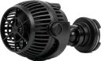 | `circulation_pump` | Circulation pump | aquarium | Pump cleaning, Clean magnet holder and mount, Descale pump, Replace wear parts kit |
|  | `fan` | Cooling fan | aquarium | Fan cleaning |
|  | `fireplace` | Fireplace or stove | home | Chimney sweeping |
|  | `heat_pump` | Heat pump | pool, home | Evaporator cleaning |
|  | `heater` | Heater | aquarium | Visual inspection, Heater test, Heater cleaning |
| 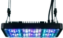 | `light` | Light | aquarium |  |
|  | `other` | Other equipment | aquarium, pool, home | Visual inspection |
|  | `pool_basin` | Pool | pool | Pool winterizing, Pool restart |
|  | `pool_filter` | Pool filter | pool | Filter backwash |
|  | `pool_pump` | Pool pump | pool | Pre-filter basket |
|  | `reactor` | Media reactor | aquarium | Reactor media replacement, Pump cleaning |
|  | `return_pump` | Return pump | aquarium | Clean suction strainer, Pump cleaning, Descale pump, Replace wear parts kit |
| 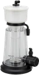 | `skimmer` | Protein skimmer | aquarium | Clean collection cup, Clean venturi and air line, Clean needle wheel, Descale skimmer body, Replace wear parts kit |
| 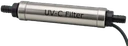 | `uv_sterilizer` | UV sterilizer | aquarium, pool | UV lamp replacement, Quartz sleeve cleaning |
|  | `ventilation` | Ventilation unit | home | Ventilation filters, Air vents cleaning |
|  | `water_softener` | Water softener | home | Softener salt, Softener servicing |

</details>

<details>
<summary><b>Equipment models</b> (7, by category and brand)</summary>

<details>
<summary><b>Circulation pump</b> (4)</summary>

<details>
<summary>Jebao (1)</summary>

|  | Model | Power | Tasks |
|---|---|---|---|
|  | SLW / MLW / SCP / SOW |  | Pump cleaning, Clean magnet holder and mount, Descale pump, Replace wear parts kit |

</details>

<details>
<summary>Tunze (3)</summary>

|  | Model | Power | Tasks |
|---|---|---|---|
|  | Silence / Silence PRO |  | Clean suction strainer, Pump cleaning, Descale pump, Replace wear parts kit |
|  | Turbelle nanostream |  | Pump cleaning, Clean magnet holder and mount, Descale pump, Replace wear parts kit |
|  | Turbelle stream / stream 3 |  | Pump cleaning, Clean magnet holder and mount, Descale pump, Replace wear parts kit |

</details>

</details>

<details>
<summary><b>Heater</b> (2)</summary>

<details>
<summary>Eheim (2)</summary>

|  | Model | Power | Tasks |
|---|---|---|---|
| 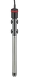 | thermocontrol 200 | 200 W | Visual inspection, Heater test, Heater cleaning |
|  | thermocontrol 300 | 300 W | Visual inspection, Heater test, Heater cleaning |

</details>

</details>

<details>
<summary><b>Return pump</b> (1)</summary>

<details>
<summary>Jebao (1)</summary>

|  | Model | Power | Tasks |
|---|---|---|---|
|  | DCP / MDP |  | Clean suction strainer, Pump cleaning, Descale pump, Replace wear parts kit |

</details>

</details>

</details>

<details>
<summary><b>Maintenance tasks</b> (42)</summary>

| Id | Task | Schedule | Icon |
|---|---|---|---|
| `ato_sensor_clean` | Level sensor cleaning | 1 months (1-3) | mdi:water-plus |
| `boiler_service` | Boiler servicing | 1 years | mdi:water-boiler |
| `carbon_replace` | Replace activated carbon | 4 weeks (2-9) | mdi:grain |
| `chiller_condenser_clean` | Condenser cleaning | 6 months (3-12) | mdi:snowflake |
| `chimney_sweep` | Chimney sweeping | 1 years | mdi:fireplace |
| `dusting` | Dusting and salt removal | 3 months (2-4) | mdi:broom |
| `fan_clean` | Fan cleaning | 3 months (1-6) | mdi:fan |
| `glass_clean` | Clean the glass | 7 days (3-21) | mdi:square-opacity |
| `heat_pump_evaporator_clean` | Evaporator cleaning | 12 months (6-12) | mdi:heat-pump |
| `heater_clean` | Heater cleaning | 3 months (1-6) | mdi:spray-bottle |
| `heater_test` | Heater test | 1 months (1-3) | mdi:thermometer-check |
| `icp_test` | ICP / water lab test | 3 months (1-6) | mdi:flask-outline |
| `magnet_holder_clean` | Clean magnet holder and mount | 6 weeks (4-17) | mdi:magnet |
| `needle_wheel_clean` | Clean needle wheel | 2 months (1-4) | mdi:fan |
| `pool_filter_backwash` | Filter backwash | 2 weeks (1-4) | mdi:filter |
| `pool_prefilter_clean` | Pre-filter basket | 1 weeks (1-4) | mdi:filter |
| `pool_restart` | Pool restart | yearly, 15/04 (-30 d) | mdi:pool |
| `pool_winterize` | Pool winterizing | yearly, 15/10 (-30 d) | mdi:snowflake |
| `probe_calibrate` | Calibrate probe | 3 months (1-6) | mdi:tune-variant |
| `probe_clean` | Clean probe | 2 months (1-4) | mdi:test-tube |
| `pump_clean` | Pump cleaning | 3 months (1-6) | mdi:pump |
| `pump_descale` | Descale pump | 6 months (3-12) | mdi:spray-bottle |
| `reactor_media_replace` | Reactor media replacement | 3 months (1-6) | mdi:flask |
| `resin_replace` | Replace resins | 2 months (1-4) | mdi:dots-hexagon |
| `rodi_filter_replace` | Replace RO/DI filters | 6 months (3-12) | mdi:water-opacity |
| `sand_vacuum` | Vacuum sand bed | 4 weeks (2-8) | mdi:vacuum |
| `skimmer_body_descale` | Descale skimmer body | 6 months (3-12) | mdi:spray-bottle |
| `skimmer_clean` | Skimmer cleaning | 1 weeks (1-4) | mdi:flask-empty-outline |
| `skimmer_cup_clean` | Clean collection cup | 2 weeks (1-4) | mdi:cup-water |
| `sock_replace` | Replace filter sock | 7 days (3-21) | mdi:sack |
| `softener_salt_refill` | Softener salt | 4 weeks (1-8) | mdi:shaker-outline |
| `softener_service` | Softener servicing | 1 years (1-2) | mdi:wrench |
| `strainer_clean` | Clean suction strainer | 6 weeks (3-9) | mdi:filter-variant |
| `sump_clean` | Clean the sump | 3 months (1-6) | mdi:waves-arrow-right |
| `uv_lamp_replace` | UV lamp replacement | 12 months (6-12) | mdi:lightbulb-on |
| `uv_quartz_clean` | Quartz sleeve cleaning | 6 months (3-12) | mdi:spray-bottle |
| `venturi_clean` | Clean venturi and air line | 4 weeks (2-8) | mdi:weather-windy |
| `visual_inspection` | Visual inspection | 1 months (1-3) | mdi:eye |
| `vmc_filter_replace` | Ventilation filters | 6 months (3-12) | mdi:air-filter |
| `vmc_vent_clean` | Air vents cleaning | 12 months (6-12) | mdi:hvac |
| `water_change` | Water change | 2 weeks (1-52) | mdi:water-sync |
| `wear_parts_replace` | Replace wear parts kit | 24 months (12-36) | mdi:cog-refresh |

</details>

<details>
<summary><b>Supplements</b> (95, 12 brands, by kind and brand)</summary>

<details>
<summary><b>KH</b> (15)</summary>

<details>
<summary>Aqua Forest (3)</summary>

|  | Supplement | 1 mL in 100 L |
|---|---|---|
|  | Component 2+ |  |
|  | KH Buffer |  |
| 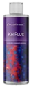 | KH Plus | +0.05 dkh KH |

</details>

<details>
<summary>ATI (1)</summary>

|  | Supplement | 1 mL in 100 L |
|---|---|---|
| 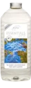 | Essential Pro 1 |  |

</details>

<details>
<summary>Brightwell (1)</summary>

|  | Supplement | 1 mL in 100 L |
|---|---|---|
|  | Reef Code B | +0.084 dkh KH |

</details>

<details>
<summary>BRS (1)</summary>

|  | Supplement | 1 mL in 100 L |
|---|---|---|
|  | Liquid alkalinity |  |

</details>

<details>
<summary>ESV (1)</summary>

|  | Supplement | 1 mL in 100 L |
|---|---|---|
|  | B-Ionic Component 1 |  |

</details>

<details>
<summary>Fauna Marine (1)</summary>

|  | Supplement | 1 mL in 100 L |
|---|---|---|
|  | Balling light KH |  |

</details>

<details>
<summary>Quantum (1)</summary>

|  | Supplement | 1 mL in 100 L |
|---|---|---|
| 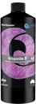 | Aragonite B |  |

</details>

<details>
<summary>Red Sea (2)</summary>

|  | Supplement | 1 mL in 100 L |
|---|---|---|
| 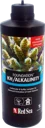 | KH/Alkalinity (Foundation B) | +0.1 dkh KH |
|  | KH/Alkalinity (Powder) |  |

</details>

<details>
<summary>Seachem (2)</summary>

|  | Supplement | 1 mL in 100 L |
|---|---|---|
|  | Reef Carbonate |  |
|  | Reef Fusion 2 | +0.123 dkh KH |

</details>

<details>
<summary>Tropic Marin (2)</summary>

|  | Supplement | 1 mL in 100 L |
|---|---|---|
|  | Balling B |  |
|  | Liquid Buffer |  |

</details>

</details>

<details>
<summary><b>Ca</b> (17)</summary>

<details>
<summary>Aqua Forest (3)</summary>

|  | Supplement | 1 mL in 100 L |
|---|---|---|
| 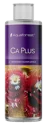 | Ca Plus | +2.0 ppm Ca |
|  | Calcium |  |
|  | Component 1+ |  |

</details>

<details>
<summary>ATI (1)</summary>

|  | Supplement | 1 mL in 100 L |
|---|---|---|
| 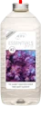 | Essential Pro 2 |  |

</details>

<details>
<summary>Brightwell (3)</summary>

|  | Supplement | 1 mL in 100 L |
|---|---|---|
|  | Calcion | +1.514 ppm Ca |
|  | Liquid Reef |  |
|  | Reef Code A | +0.606 ppm Ca |

</details>

<details>
<summary>BRS (1)</summary>

|  | Supplement | 1 mL in 100 L |
|---|---|---|
|  | Liquid Calcium |  |

</details>

<details>
<summary>ESV (1)</summary>

|  | Supplement | 1 mL in 100 L |
|---|---|---|
|  | B-Ionic Component 2 |  |

</details>

<details>
<summary>Fauna Marine (1)</summary>

|  | Supplement | 1 mL in 100 L |
|---|---|---|
|  | Balling light Ca |  |

</details>

<details>
<summary>Quantum (1)</summary>

|  | Supplement | 1 mL in 100 L |
|---|---|---|
| 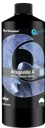 | Aragonite A |  |

</details>

<details>
<summary>Red Sea (2)</summary>

|  | Supplement | 1 mL in 100 L |
|---|---|---|
| 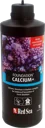 | Calcium (Foundation A) | +2.0 ppm Ca |
|  | Calcium (Powder) |  |

</details>

<details>
<summary>Seachem (3)</summary>

|  | Supplement | 1 mL in 100 L |
|---|---|---|
|  | Reef Calcium | +0.48 ppm Ca |
|  | Reef Complete | +1.6 ppm Ca |
|  | Reef Fusion 1 | +1.0 ppm Ca |

</details>

<details>
<summary>Tropic Marin (1)</summary>

|  | Supplement | 1 mL in 100 L |
|---|---|---|
|  | Balling A |  |

</details>

</details>

<details>
<summary><b>Mg</b> (12)</summary>

<details>
<summary>Aqua Forest (3)</summary>

|  | Supplement | 1 mL in 100 L |
|---|---|---|
|  | Component 3+ |  |
|  | Magnesium |  |
| 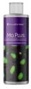 | Mg Plus | +1.0 ppm Mg |

</details>

<details>
<summary>Brightwell (1)</summary>

|  | Supplement | 1 mL in 100 L |
|---|---|---|
|  | Hydrate - MG | +0.738 ppm Mg |

</details>

<details>
<summary>BRS (1)</summary>

|  | Supplement | 1 mL in 100 L |
|---|---|---|
|  | Magnesium Mix |  |

</details>

<details>
<summary>ESV (1)</summary>

|  | Supplement | 1 mL in 100 L |
|---|---|---|
|  | B-Ionic Magnesium |  |

</details>

<details>
<summary>Fauna Marine (1)</summary>

|  | Supplement | 1 mL in 100 L |
|---|---|---|
|  | Balling light Mg |  |

</details>

<details>
<summary>Quantum (1)</summary>

|  | Supplement | 1 mL in 100 L |
|---|---|---|
| 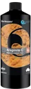 | Aragonite C |  |

</details>

<details>
<summary>Red Sea (2)</summary>

|  | Supplement | 1 mL in 100 L |
|---|---|---|
| 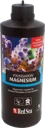 | Magnesium (Foundation C) | +1.0 ppm Mg |
|  | Magnesium (Powder) |  |

</details>

<details>
<summary>Tropic Marin (2)</summary>

|  | Supplement | 1 mL in 100 L |
|---|---|---|
|  | Balling C |  |
| 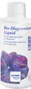 | Bio-Magnesium |  |

</details>

</details>

<details>
<summary><b>trace elements</b> (27)</summary>

<details>
<summary>Brightwell (5)</summary>

|  | Supplement | 1 mL in 100 L |
|---|---|---|
|  | Ferrion | +0.038 ppm Fe |
|  | Koralcolor |  |
|  | Potassion | +0.795 ppm K |
|  | Replenish |  |
|  | Strontion |  |

</details>

<details>
<summary>BRS (1)</summary>

|  | Supplement | 1 mL in 100 L |
|---|---|---|
|  | Part C |  |

</details>

<details>
<summary>ESV (1)</summary>

|  | Supplement | 1 mL in 100 L |
|---|---|---|
|  | Transition elements |  |

</details>

<details>
<summary>Fauna Marine (6)</summary>

|  | Supplement | 1 mL in 100 L |
|---|---|---|
|  | Balling light  trace 1 |  |
|  | Balling light  trace 2 |  |
|  | Balling light  trace 3 |  |
|  | Blue trace elements |  |
|  | Green trace elements |  |
|  | Red trace elements |  |

</details>

<details>
<summary>Quantum (3)</summary>

|  | Supplement | 1 mL in 100 L |
|---|---|---|
| 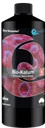 | Bio Kalium |  |
| 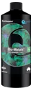 | Bio Metals |  |
| 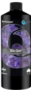 | Gbio Gen |  |

</details>

<details>
<summary>Red Sea (5)</summary>

|  | Supplement | 1 mL in 100 L |
|---|---|---|
| 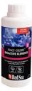 | Bio Active (Colors D) |  |
| 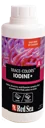 | Iodine (Colors A) | +0.03 ppm I |
| 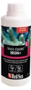 | Iron (Colors C) | +0.02 ppm Fe |
| 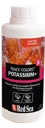 | Potassium (Colors B) | +1.75 ppm K |
| 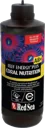 | Reef Energy Plus |  |

</details>

<details>
<summary>Seachem (3)</summary>

|  | Supplement | 1 mL in 100 L |
|---|---|---|
|  | Reef Iodine |  |
|  | Reef Strontium |  |
|  | Reef Trace |  |

</details>

<details>
<summary>Tropic Marin (3)</summary>

|  | Supplement | 1 mL in 100 L |
|---|---|---|
|  | A Element |  |
|  | K Element |  |
| 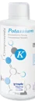 | Potassium | +1.009 ppm K |

</details>

</details>

<details>
<summary><b>nutrients</b> (5)</summary>

<details>
<summary>ESV (1)</summary>

|  | Supplement | 1 mL in 100 L |
|---|---|---|
|  | Transition elements plus |  |

</details>

<details>
<summary>Red Sea (1)</summary>

|  | Supplement | 1 mL in 100 L |
|---|---|---|
| 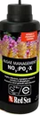 | NO3PO4-X |  |

</details>

<details>
<summary>Tropic Marin (3)</summary>

|  | Supplement | 1 mL in 100 L |
|---|---|---|
|  | Elimi-NP |  |
| 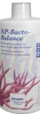 | NP-Bacto-Balance |  |
|  | Plus-NP |  |

</details>

</details>

<details>
<summary><b>food</b> (7)</summary>

<details>
<summary>Brightwell (2)</summary>

|  | Supplement | 1 mL in 100 L |
|---|---|---|
|  | KoralAmino |  |
|  | Restore |  |

</details>

<details>
<summary>Fauna Marine (2)</summary>

|  | Supplement | 1 mL in 100 L |
|---|---|---|
|  | Amin |  |
|  | Min S |  |

</details>

<details>
<summary>Quantum (1)</summary>

|  | Supplement | 1 mL in 100 L |
|---|---|---|
| 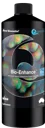 | Bio enhance |  |

</details>

<details>
<summary>Seachem (1)</summary>

|  | Supplement | 1 mL in 100 L |
|---|---|---|
|  | Reef Plus |  |

</details>

<details>
<summary>Tropic Marin (1)</summary>

|  | Supplement | 1 mL in 100 L |
|---|---|---|
| 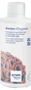 | Amino Organic |  |

</details>

</details>

<details>
<summary><b>bundle</b> (1)</summary>

<details>
<summary>Red Sea (1)</summary>

|  | Supplement | 1 mL in 100 L |
|---|---|---|
|  | ReefCare |  |

</details>

</details>

<details>
<summary><b>brine</b> (1)</summary>

<details>
<summary>DIY (1)</summary>

|  | Supplement | 1 mL in 100 L |
|---|---|---|
| 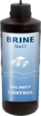 | Brine | salinity (200 g/L) |

</details>

</details>

<details>
<summary><b>other</b> (10)</summary>

<details>
<summary>Red Sea (4)</summary>

|  | Supplement | 1 mL in 100 L |
|---|---|---|
| 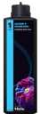 | Part 1: Calcium & Magnesium |  |
| 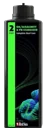 | Part 2: KH/Alkalinity &PH stabilizer |  |
| 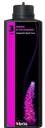 | Part 3: Iodine & Potassium |  |
| 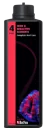 | Part 4: Iron & Bioactive elements |  |

</details>

<details>
<summary>Triton (4)</summary>

|  | Supplement | 1 mL in 100 L |
|---|---|---|
|  | Core7 elements 1 |  |
|  | Core7 elements 2 |  |
|  | Core7 elements 3A |  |
|  | Core7 elements 3B |  |

</details>

<details>
<summary>Tropic Marin (2)</summary>

|  | Supplement | 1 mL in 100 L |
|---|---|---|
| 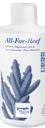 | All-For-Reef |  |
| 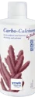 | Carbo Calcium |  |

</details>

</details>

</details>

<details>
<summary><b>Water parameters</b> (14, by category)</summary>

<details>
<summary><b>physical</b> (4)</summary>

| Symbol | Parameter | Unit | Reef range |
|---|---|---|---|
| ORP | ORP | mV | 300-450 (380) |
| pH | pH | pH | 7.8-8.4 (8.2) |
| Sal | Salinity | ppt | 33-35 (35) |
| T | Temperature | °C | 24-27 (25.5) |

</details>

<details>
<summary><b>alkalinity</b> (1)</summary>

| Symbol | Parameter | Unit | Reef range |
|---|---|---|---|
| KH | Alkalinity | dKH | 7-8.5 (8) |

</details>

<details>
<summary><b>major element</b> (2)</summary>

| Symbol | Parameter | Unit | Reef range |
|---|---|---|---|
| Ca | Calcium | ppm | 410-450 (430) |
| Mg | Magnesium | ppm | 1250-1400 (1340) |

</details>

<details>
<summary><b>minor element</b> (2)</summary>

| Symbol | Parameter | Unit | Reef range |
|---|---|---|---|
| K | Potassium | ppm | 380-420 (400) |
| Sr | Strontium | ppm | 8-10 (9) |

</details>

<details>
<summary><b>trace element</b> (2)</summary>

| Symbol | Parameter | Unit | Reef range |
|---|---|---|---|
| I | Iodine | ppb | 40-80 (60) |
| Fe | Iron | ppb | 5-20 (5) |

</details>

<details>
<summary><b>nutrient</b> (3)</summary>

| Symbol | Parameter | Unit | Reef range |
|---|---|---|---|
| NO3 | Nitrate | ppm | 1-10 (5) |
| NO2 | Nitrite | ppm | 0-0.05 (0) |
| PO4 | Phosphate | ppm | 0.02-0.1 (0.05) |

</details>

</details>

<details>
<summary><b>Water tests</b> (9, 3 brands, by parameter and brand)</summary>

<details>
<summary><b>KH</b> (3)</summary>

<details>
<summary>Colombo (1)</summary>

|  | Test | Parameters |
|---|---|---|
|  | Marine KH Test | KH (titration) |

</details>

<details>
<summary>Red Sea (1)</summary>

|  | Test | Parameters |
|---|---|---|
|  | Reef Foundation Pro Alkalinity Test | KH (titration) |

</details>

<details>
<summary>Salifert (1)</summary>

|  | Test | Parameters |
|---|---|---|
|  | KH/Alkalinity Profi Test | KH (titration) |

</details>

</details>

<details>
<summary><b>Ca</b> (3)</summary>

<details>
<summary>Colombo (1)</summary>

|  | Test | Parameters |
|---|---|---|
|  | Marine Calcium Test | Ca (titration) |

</details>

<details>
<summary>Red Sea (1)</summary>

|  | Test | Parameters |
|---|---|---|
|  | Reef Foundation Pro Calcium Test | Ca (titration) |

</details>

<details>
<summary>Salifert (1)</summary>

|  | Test | Parameters |
|---|---|---|
|  | Calcium Profi Test | Ca (titration) |

</details>

</details>

<details>
<summary><b>Mg</b> (2)</summary>

<details>
<summary>Red Sea (1)</summary>

|  | Test | Parameters |
|---|---|---|
|  | Reef Foundation Pro Magnesium Test | Mg (titration) |

</details>

<details>
<summary>Salifert (1)</summary>

|  | Test | Parameters |
|---|---|---|
|  | Mg Profi Test | Mg (titration) |

</details>

</details>

<details>
<summary><b>K</b> (1)</summary>

<details>
<summary>Colombo (1)</summary>

|  | Test | Parameters |
|---|---|---|
|  | Kalium Potassium Test (colour 2) | K (titration) |

</details>

</details>

</details>

<!-- catalog:end -->

## License

Catalog data and visuals: CC BY 4.0. Scripts: MIT. See [LICENSE.md](LICENSE.md).
