# reeftech-catalog

Data catalog of the ReefTech ecosystem: non-connected equipment with their
maintenance tasks, and dosing supplements. Adding a heater model or a new
supplement is a pull request here, not a new release of the integrations or of
the cards.

| Section | Content | Downloaded by | Shown by |
|---|---|---|---|
| `equipment` | task library, equipment categories (generic image and tasks), equipment models | [reef_maintenance](https://github.com/Elwinmage/ha-reef-maintenance-component) (scope `aquarium`), [maintenance_hub](https://github.com/Elwinmage/ha-maintenance-hub) (all scopes) | ha-reef-card (RSPower sockets, maintenance view), maintenance hub card |
| `supplements` | supplements, bottle visuals, dosing data | [redsea](https://github.com/Elwinmage/ha-reefbeat-component) | ha-reef-card (ReefDose) |

The cards never access the network: integrations download the releases, check
them, keep them under `<config>` and serve them locally, with a built-in
snapshot for their first start and for offline installs. The integration side
is written once in [`client/`](client) and copied into each integration by
`scripts/sync_client.py`. See [doc/consumers.md](doc/consumers.md).

## Layout

```
schema/                         JSON schemas (2020-12)
equipment/
  tasks/<task_id>.json          maintenance task templates
  categories/<category_id>/
    category.json               name, scopes, icon, default tasks
    image.webp                  generic visual (optional)
    thumb.webp                  small visual for lists (optional)
  items/<item_id>/
    item.json                   category, brand, model, power, task overrides
    image.webp / thumb.webp     (optional, category visual otherwise)
supplements/
  items/<supplement_id>/
    supplement.json             kind, colour, dosing data
    image.webp / thumb.webp     bottle visual (optional, generic bottle otherwise)
scripts/                        validate.py, make_release.py, sync_client.py
client/                         catalog client copied into the integrations
```

A file or folder name is the entry id. Ids are **stable**: user
configurations refer to them, so an entry is never renamed, only removed.

## Equipment

- **Scopes** (`aquarium`, `pool`, `home`) say where an equipment lives.
  reef_maintenance keeps `aquarium` entries, maintenance_hub keeps all of them.
- A **category** works on its own: an equipment linked to “heater” already gets
  a visual and the usual heater tasks. A **model** only refines it (own visual,
  nominal power, other intervals).
- **Tasks** are shared templates (`equipment/tasks/`) carrying names and
  descriptions in every language. Categories and models reference them and may
  override `schedule` and `regulatory`. A model keeps its category tasks unless
  `inherit_maintenance` is `false`.
- **Schedules** are either `interval` (unit `days`/`weeks`/`months`/`years`,
  with a default and the bounds the user may choose within) or `seasonal`
  (yearly anchor date, task due `window_days` before it).

```json
{
  "category": "heater",
  "brand": "Eheim",
  "model": "thermocontrol 200",
  "power_w": 200,
  "maintenance": [
    { "task": "heater_clean", "schedule": { "type": "interval", "unit": "months", "every": { "default": 6, "min": 3, "max": 12 } } }
  ]
}
```

## Supplements

The 95 supplements of ha-reef-card (12 brands, with their bottle visuals) live
here; the card no longer embeds them.

- `uid`: Red Sea cloud uid (the card and redsea look supplements up by it);
  `fullname`: `<brand> - <name>` as known by the ReefBeat library. Both are
  unique and never change.
- `name` is the product name as printed (not translated); `display_name` and
  `short_name` are the labels of the dosing head and of the bottle visual.
- `sizes`: bottle sizes in mL offered for the container volume.
- `kind`: `kh`, `ca`, `mg`, `trace`, `nutrient`, `food`, `bundle`, `brine`,
  `other`.
- `bundle` (kind `bundle` only): its parts, each one another supplement of the
  catalog, with a slot and a dosing ratio to part 1 (Red Sea ReefCare).
- `effects`: raise of a parameter for **1 mL in 100 L**, used by the automatic
  dose proposal. Values outside plausible bounds are rejected by the checks.
- `verified`: dosing data checked against the manufacturer, with a `source`.
  Unverified effects are never used for automatic proposals.
- `brine` (DIY Brine) is the only kind with `concentration_g_l` and the only
  one allowed to drive salinity regulation (`"regulation": ["salinity"]`); its
  raise is computed from the concentration, so it has no `effects`.

## Releases

*Actions → Release* publishes one section or both (`all`, the default), with
a version like `2026.11.0`. Each section keeps its own releases; with `all`, a
section without any change since its previous release is skipped.
`min_integration` takes one list for both sections (`redsea=2.1.0
reef_maintenance=0.3.0`), each section keeping its own consumers.

- `<section>-<version>`: the archives of the entries that changed, the manifest
  and the notes. Unchanged entries keep pointing to the release that built them,
  so integrations only download what changed. **Never delete a versioned
  release.**
- `<section>-latest`: only the current `manifest.json`, at a fixed URL.

After a release, run `sync_client.py` so that the next version of each
integration ships an up-to-date built-in snapshot.

The manifest gives, per entry, its kind, scopes, archive, sha256, size and the
version that last changed it, plus the oldest version of each integration able
to read the section (`min_integration`).

## Checks

```
pip install -r requirements.txt
pre-commit install                  # same checks as the CI, before each commit
python scripts/validate.py          # errors fail, warnings are listed
python scripts/validate.py --strict # warnings fail too
python scripts/readme_catalog.py    # refresh the lists of this README
pytest --cov=scripts --cov=client
python scripts/sync_client.py --base .. [--check]  # refresh the integrations' copies
```

Warnings are missing translations of tasks and equipment (`en` is
mandatory, `fr de es it pl pt` expected), missing visuals and unverified
dosing data. See
[CONTRIBUTING.md](CONTRIBUTING.md) to add an entry.

## Catalog content

The lists below are written by `scripts/readme_catalog.py` from the catalog
itself (`--check` in the CI and pre-commit fails when they are out of date):
run it after adding or changing an entry.

<!-- catalog:begin -->
<!-- Generated by scripts/readme_catalog.py: do not edit by hand -->

### Equipment categories (18)

| | Id | Category | Scopes | Default tasks |
|---|---|---|---|---|
|  | `ato_pump` | Top-off pump | aquarium | Level sensor cleaning, Pump cleaning |
|  | `boiler` | Boiler | home | Boiler servicing |
|  | `chiller` | Chiller | aquarium | Condenser cleaning |
|  | `circulation_pump` | Circulation pump | aquarium | Pump cleaning |
|  | `fan` | Cooling fan | aquarium | Fan cleaning |
|  | `fireplace` | Fireplace or stove | home | Chimney sweeping |
|  | `heat_pump` | Heat pump | pool, home | Evaporator cleaning |
|  | `heater` | Heater | aquarium | Visual inspection, Heater test, Heater cleaning |
|  | `other` | Other equipment | aquarium, pool, home | Visual inspection |
|  | `pool_basin` | Pool | pool | Pool winterizing, Pool restart |
|  | `pool_filter` | Pool filter | pool | Filter backwash |
|  | `pool_pump` | Pool pump | pool | Pre-filter basket |
|  | `reactor` | Media reactor | aquarium | Reactor media replacement, Pump cleaning |
|  | `return_pump` | Return pump | aquarium | Pump cleaning |
|  | `skimmer` | Protein skimmer | aquarium | Skimmer cleaning, Pump cleaning |
|  | `uv_sterilizer` | UV sterilizer | aquarium, pool | UV lamp replacement, Quartz sleeve cleaning |
|  | `ventilation` | Ventilation unit | home | Ventilation filters, Air vents cleaning |
|  | `water_softener` | Water softener | home | Softener salt, Softener servicing |

### Equipment models (1)

| | Brand | Model | Category | Power | Tasks |
|---|---|---|---|---|---|
|  | Eheim | thermocontrol 200 | Heater | 200 W | Visual inspection, Heater test, Heater cleaning |

### Maintenance tasks (23)

| Id | Task | Schedule | Icon |
|---|---|---|---|
| `ato_sensor_clean` | Level sensor cleaning | 1 months (1-3) | mdi:water-plus |
| `boiler_service` | Boiler servicing | 1 years | mdi:water-boiler |
| `chiller_condenser_clean` | Condenser cleaning | 6 months (3-12) | mdi:snowflake |
| `chimney_sweep` | Chimney sweeping | 1 years | mdi:fireplace |
| `dusting` | Dusting and salt removal | 3 months (2-4) | mdi:broom |
| `fan_clean` | Fan cleaning | 3 months (1-6) | mdi:fan |
| `heat_pump_evaporator_clean` | Evaporator cleaning | 12 months (6-12) | mdi:heat-pump |
| `heater_clean` | Heater cleaning | 3 months (1-6) | mdi:spray-bottle |
| `heater_test` | Heater test | 1 months (1-3) | mdi:thermometer-check |
| `pool_filter_backwash` | Filter backwash | 2 weeks (1-4) | mdi:filter |
| `pool_prefilter_clean` | Pre-filter basket | 1 weeks (1-4) | mdi:filter |
| `pool_restart` | Pool restart | yearly, 15/04 (-30 d) | mdi:pool |
| `pool_winterize` | Pool winterizing | yearly, 15/10 (-30 d) | mdi:snowflake |
| `pump_clean` | Pump cleaning | 3 months (1-6) | mdi:pump |
| `reactor_media_replace` | Reactor media replacement | 3 months (1-6) | mdi:flask |
| `skimmer_clean` | Skimmer cleaning | 1 weeks (1-4) | mdi:flask-empty-outline |
| `softener_salt_refill` | Softener salt | 4 weeks (1-8) | mdi:shaker-outline |
| `softener_service` | Softener servicing | 1 years (1-2) | mdi:wrench |
| `uv_lamp_replace` | UV lamp replacement | 12 months (6-12) | mdi:lightbulb-on |
| `uv_quartz_clean` | Quartz sleeve cleaning | 6 months (3-12) | mdi:spray-bottle |
| `visual_inspection` | Visual inspection | 1 months (1-3) | mdi:eye |
| `vmc_filter_replace` | Ventilation filters | 6 months (3-12) | mdi:air-filter |
| `vmc_vent_clean` | Air vents cleaning | 12 months (6-12) | mdi:hvac |

### Supplements (95, 12 brands)

| | Brand | Supplement | Kind | 1 mL in 100 L |
|---|---|---|---|---|
| 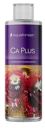 | Aqua Forest | Ca Plus | Ca | +2.0 ppm Ca |
|  | Aqua Forest | Calcium | Ca |  |
|  | Aqua Forest | Component 1+ | Ca |  |
|  | Aqua Forest | Component 2+ | KH |  |
|  | Aqua Forest | Component 3+ | Mg |  |
|  | Aqua Forest | KH Buffer | KH |  |
| 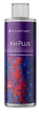 | Aqua Forest | KH Plus | KH | +0.05 dkh KH |
|  | Aqua Forest | Magnesium | Mg |  |
| 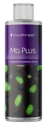 | Aqua Forest | Mg Plus | Mg | +1.0 ppm Mg |
| 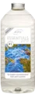 | ATI | Essential Pro 1 | KH |  |
| 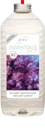 | ATI | Essential Pro 2 | Ca |  |
|  | Brightwell | Calcion | Ca | +1.514 ppm Ca |
|  | Brightwell | Ferrion | trace elements | +0.038 ppm Fe |
|  | Brightwell | Hydrate - MG | Mg | +0.738 ppm Mg |
|  | Brightwell | KoralAmino | food |  |
|  | Brightwell | Koralcolor | trace elements |  |
|  | Brightwell | Liquid Reef | Ca |  |
|  | Brightwell | Potassion | trace elements | +0.795 ppm K |
|  | Brightwell | Reef Code A | Ca | +0.606 ppm Ca |
|  | Brightwell | Reef Code B | KH | +0.084 dkh KH |
|  | Brightwell | Replenish | trace elements |  |
|  | Brightwell | Restore | food |  |
|  | Brightwell | Strontion | trace elements |  |
|  | BRS | Liquid alkalinity | KH |  |
|  | BRS | Liquid Calcium | Ca |  |
|  | BRS | Magnesium Mix | Mg |  |
|  | BRS | Part C | trace elements |  |
| 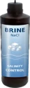 | DIY | Brine | brine | salinity ({'default': 200, 'min': 100, 'max': 300} g/L) |
|  | ESV | B-Ionic Component 1 | KH |  |
|  | ESV | B-Ionic Component 2 | Ca |  |
|  | ESV | B-Ionic Magnesium | Mg |  |
|  | ESV | Transition elements | trace elements |  |
|  | ESV | Transition elements plus | nutrients |  |
|  | Fauna Marine | Amin | food |  |
|  | Fauna Marine | Balling light  trace 1 | trace elements |  |
|  | Fauna Marine | Balling light  trace 2 | trace elements |  |
|  | Fauna Marine | Balling light  trace 3 | trace elements |  |
|  | Fauna Marine | Balling light Ca | Ca |  |
|  | Fauna Marine | Balling light KH | KH |  |
|  | Fauna Marine | Balling light Mg | Mg |  |
|  | Fauna Marine | Blue trace elements | trace elements |  |
|  | Fauna Marine | Green trace elements | trace elements |  |
|  | Fauna Marine | Min S | food |  |
|  | Fauna Marine | Red trace elements | trace elements |  |
| 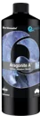 | Quantum | Aragonite A | Ca |  |
| 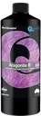 | Quantum | Aragonite B | KH |  |
| 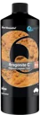 | Quantum | Aragonite C | Mg |  |
| 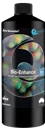 | Quantum | Bio enhance | food |  |
| 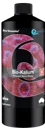 | Quantum | Bio Kalium | trace elements |  |
| 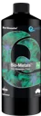 | Quantum | Bio Metals | trace elements |  |
| 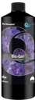 | Quantum | Gbio Gen | trace elements |  |
| 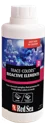 | Red Sea | Bio Active (Colors D) | trace elements |  |
| 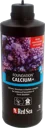 | Red Sea | Calcium (Foundation A) | Ca | +2.0 ppm Ca |
|  | Red Sea | Calcium (Powder) | Ca |  |
| 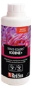 | Red Sea | Iodine (Colors A) | trace elements | +0.03 ppm I |
| 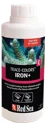 | Red Sea | Iron (Colors C) | trace elements | +0.02 ppm Fe |
| 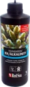 | Red Sea | KH/Alkalinity (Foundation B) | KH | +0.1 dkh KH |
|  | Red Sea | KH/Alkalinity (Powder) | KH |  |
| 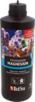 | Red Sea | Magnesium (Foundation C) | Mg | +1.0 ppm Mg |
|  | Red Sea | Magnesium (Powder) | Mg |  |
| 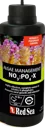 | Red Sea | NO3PO4-X | nutrients |  |
| 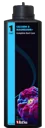 | Red Sea | Part 1: Calcium & Magnesium | other |  |
| 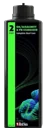 | Red Sea | Part 2: KH/Alkalinity &PH stabilizer | other |  |
| 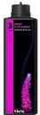 | Red Sea | Part 3: Iodine & Potassium | other |  |
| 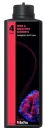 | Red Sea | Part 4: Iron & Bioactive elements | other |  |
| 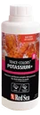 | Red Sea | Potassium (Colors B) | trace elements | +1.75 ppm K |
| 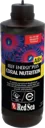 | Red Sea | Reef Energy Plus | trace elements |  |
|  | Red Sea | ReefCare | bundle |  |
|  | Seachem | Reef Calcium | Ca | +0.48 ppm Ca |
|  | Seachem | Reef Carbonate | KH |  |
|  | Seachem | Reef Complete | Ca | +1.6 ppm Ca |
|  | Seachem | Reef Fusion 1 | Ca | +1.0 ppm Ca |
|  | Seachem | Reef Fusion 2 | KH | +0.123 dkh KH |
|  | Seachem | Reef Iodine | trace elements |  |
|  | Seachem | Reef Plus | food |  |
|  | Seachem | Reef Strontium | trace elements |  |
|  | Seachem | Reef Trace | trace elements |  |
|  | Triton | Core7 elements 1 | other |  |
|  | Triton | Core7 elements 2 | other |  |
|  | Triton | Core7 elements 3A | other |  |
|  | Triton | Core7 elements 3B | other |  |
|  | Tropic Marin | A Element | trace elements |  |
| 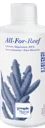 | Tropic Marin | All-For-Reef | other |  |
| 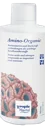 | Tropic Marin | Amino Organic | food |  |
|  | Tropic Marin | Balling A | Ca |  |
|  | Tropic Marin | Balling B | KH |  |
|  | Tropic Marin | Balling C | Mg |  |
| 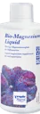 | Tropic Marin | Bio-Magnesium | Mg |  |
| 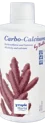 | Tropic Marin | Carbo Calcium | other |  |
|  | Tropic Marin | Elimi-NP | nutrients |  |
|  | Tropic Marin | K Element | trace elements |  |
|  | Tropic Marin | Liquid Buffer | KH |  |
| 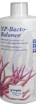 | Tropic Marin | NP-Bacto-Balance | nutrients |  |
|  | Tropic Marin | Plus-NP | nutrients |  |
| 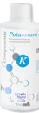 | Tropic Marin | Potassium | trace elements | +1.009 ppm K |

<!-- catalog:end -->

## License

Catalog data and visuals: CC BY 4.0. Scripts: MIT. See [LICENSE.md](LICENSE.md).
